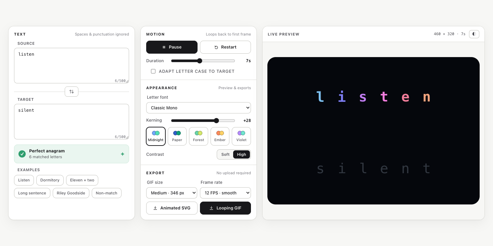
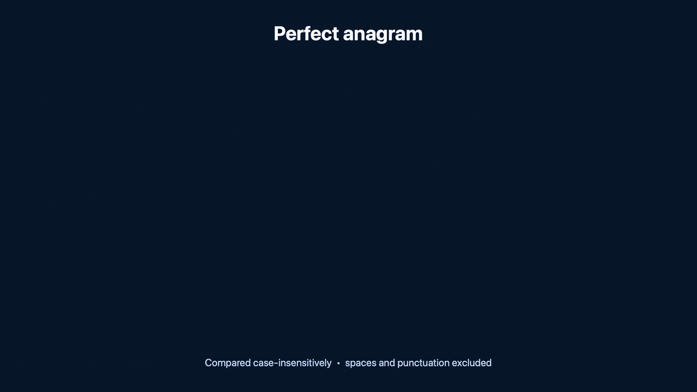

# Anagramator

Paste two phrases. If their letters and numbers match, Anagramator shows how each character moves from one phrase to the other. The comparison and animation run in the browser, so the text never leaves the page.

[Open Anagramator](https://okturan.github.io/anagramator/)

[](https://okturan.github.io/anagramator/)

This is the actual editor, captured from `index.html` at 1440×720. The GIF below records the same interface while its live preview animates.



## What it does

- Reports the extra or missing characters when the two inputs do not match.
- Animates up to 400 matched characters with adjustable timing and spacing.
- Includes five color themes, six font choices, light and dark modes, and a case-adaptation option.
- Exports a self-contained animated SVG or a looping GIF at 8, 12, or 16 frames per second.
- Runs as one HTML file with no build step and no server-side code.

## Run it locally

Open `index.html` directly, or serve the folder if your browser limits local font requests:

```sh
python3 -m http.server 8000
```

Then visit `http://localhost:8000`.

Run the analyzer checks with:

```sh
node test.mjs
```

The default Classic Mono font works offline. The other five font choices are loaded from Google Fonts and need a network connection. Large, high-frame-rate GIF exports can take a while because every frame is rendered and encoded in the browser.

## Rebuild the demo GIF

The checked-in GIF records the actual `index.html` editor at 1200×600 from a 15 FPS browser capture. It uses gifski's cross-frame palettes and temporal dithering at quality 95. On macOS with Google Chrome and gifski installed:

```sh
node render_editor_gif.mjs
```

`render_svg_gif.mjs` is a separate helper for turning an exported animated SVG into a GIF. It expects Google Chrome and FFmpeg.
